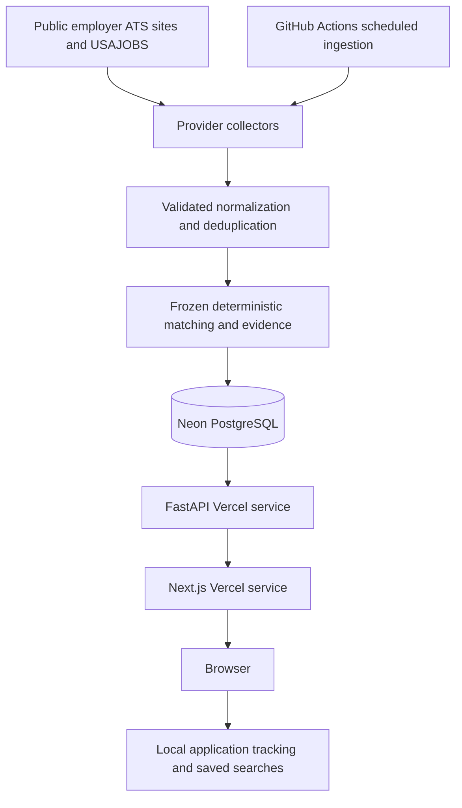

# GradJobs

**Find the opportunities built for the start of your career.**

[Live application](https://gradjobs-drab.vercel.app) · [GitHub repository](https://github.com/Sheks17/GradJobs)

GradJobs is a live job discovery and tracking application for U.S. students, graduates, and early-career technology candidates. It collects supported public employer job boards, preserves source data, groups clear duplicates, and explains a rule-based early-career score. It does not claim complete coverage of the job market.

## Problem and architecture

Early-career candidates face fragmented employer sites and junior-sounding postings that require substantial experience. GradJobs brings real postings into a consistent, searchable model and surfaces the requirements behind each score. Applications always go to the original employer site.



The API serves requests; ingestion runs in GitHub Actions, outside Vercel requests. Repository secrets supply production database and federal API credentials. A cron trigger runs every 30 minutes; executions are serialized and can take longer than the trigger interval. This is periodic discovery, not real-time job-market coverage.

See [design decisions](docs/design-decisions.md), [MVP completion and measured scale](docs/mvp-completion.md), and [deployment operations](docs/deployment.md). Current database counts and source health are exposed at `/api/stats`, `/api/stats/providers`, `/api/sources`, and the read-only `/admin/ingestion` page.

## What is included

The MVP supports Greenhouse, Lever, Ashby, SmartRecruiters, USAJOBS and Workday through one normalized job model. It provides freshness and relevance filters, explainable scores, original employer application links, browser-local application tracking and named saved searches. Source health and ingestion history make partial failures visible. Current timestamped scale and verification evidence are in the [completion report](docs/mvp-completion.md).

Phase 3 adds separate required/preferred experience, contextual title levels, deterministic skills, fit evidence, confidence and conflict flags, and skill/category and quick filters. The user confirmed review of all 220 Phase 3 postings: precision 100%, recall 98.7%, F1 99.4%, and four-class accuracy 99.1%. See [matching methodology](docs/matching.md) and [validation provenance and report](docs/phase3-validation.md).

Phase 4A adds SmartRecruiters and the official USAJOBS API, provider configuration/capabilities, bounded concurrent ingestion, provider health, federal metadata, closing deadlines, and advanced provider filtering. See [provider setup](docs/providers.md) and [measured Phase 4A verification](docs/phase4a-provider-expansion.md). Matching version 3.0.0 and cutoff 50 remain frozen. The separate 100-posting provider pilot has blank labels for later independent review; prior metrics do not establish accuracy on new providers. Local evaluation datasets, review records, and database snapshots are excluded from the public repository.

## Production deployment

See [GitHub and Vercel deployment](docs/deployment.md) for the two-service Vercel configuration, PostgreSQL setup, secret names, scheduled ingestion, and public smoke checks. Deploy from the repository root; the frontend uses `/api` in production when `NEXT_PUBLIC_API_URL` is unset. The application requires a hosted database populated through ingestion.

- Next.js App Router, React, TypeScript, Tailwind CSS, responsive dashboard and job details.
- FastAPI, Pydantic, SQLAlchemy 2.x, PostgreSQL JSONB, and Alembic migrations.
- Greenhouse, Lever, Ashby, SmartRecruiters, USAJOBS and Workday collectors with timeouts, throttling, retries, validation, savepoints and structured logs.
- Search, role, seniority, workplace, state, company, salary, experience, score, and date filtering with stable pagination.
- Transparent experience extraction, title-based seniority, role families, and score explanations.
- Browser-local saved/applied/interviewing/offer/rejected/archived states and named saved searches. No accounts or server-side personal records.
- Verified employer registry, one scoped federal search source, source/provider health, safe job closure and scheduled ingestion. Counts come from the database rather than a hardcoded coverage claim.
- Optional fictional demo listings remain available through an explicit filter.
- Unit/integration tests, browser smoke tests, and a PostgreSQL CI workflow.

## Repository

```text
apps/web/                     Next.js UI, components, client utilities, tests
services/api/app/
  api/                        FastAPI routes
  core/                       Environment configuration and JSON logging
  db/                         Engine, sessions, declarative base
  models/                     Jobs and job sources
  schemas/                    Query and response validation
  repositories/               Querying, deduplication, upserts
  seed.py                     Idempotent demo seed
services/api/migrations/      Versioned Alembic migrations
collectors/                   Provider adapters and sync CLI
collectors/normalizers/       Text, URL, company, and location normalization
matching/                     Experience, seniority, roles, explainable scoring
shared/                       Normalized ingestion contract and shared constants
tests/                        Backend tests and offline provider fixtures
infrastructure/               Deployment and operational guidance
docs/                         Architecture, ingestion, matching, verification
docker-compose.yml            Local PostgreSQL 17
requirements-dev.lock          Exact tested Python dependency versions
.github/workflows/ci.yml       Backend/PostgreSQL and frontend checks
```

## Prerequisites

Python 3.12+, Node.js 24 LTS, npm, and Docker Compose v2 (or an existing PostgreSQL database). Commands below run from the repository root unless a directory change is shown. Windows PowerShell users can substitute `npm.cmd` if script execution policy blocks `npm`.

## Local setup

```powershell
Copy-Item .env.example .env
docker compose up -d
python -m venv .venv
.\.venv\Scripts\Activate.ps1
python -m pip install -r requirements-dev.lock
python -m pip install --no-deps -e .
python -m alembic upgrade head
python -m collectors.seed_sources
python -m collectors.sync_all
python -m uvicorn services.api.app.main:app --reload --host 127.0.0.1 --port 8000
```

On macOS/Linux, use `cp .env.example .env` and `source .venv/bin/activate` instead of the PowerShell copy/activation commands. If activation is blocked on Windows, use `.\.venv\Scripts\python.exe` directly; changing execution policy is unnecessary.

In another terminal:

```powershell
cd apps/web
Copy-Item .env.example .env.local
npm ci
npm run dev
```

Open [GradJobs](http://localhost:3000) and [interactive API docs](http://localhost:8000/docs). The frontend makes browser requests to `NEXT_PUBLIC_API_URL`; the API does not need to run during a frontend build. `NEXT_PUBLIC_*` variables are public, fixed at build time, and must never contain credentials.

The Compose database binds only to localhost and stores data in a named volume. The example credentials are local development defaults. Set your own database credentials for a deployment. `docker compose down` stops PostgreSQL without removing its data.

### Optional SQLite preview

When PostgreSQL is unavailable, the same schema supports a single-process preview and offline tests:

```powershell
$env:DATABASE_URL='sqlite:///./gradjobs-live.db'
python -m alembic upgrade head
python -m collectors.seed_sources
python -m collectors.sync_all
python -m uvicorn services.api.app.main:app --host 127.0.0.1 --port 8000
```

On macOS/Linux use `export DATABASE_URL=sqlite:///./gradjobs-live.db`. This is a development fallback: PostgreSQL JSONB and the ingestion advisory lock are not available in SQLite. Return to PostgreSQL by removing the shell override (`Remove-Item Env:DATABASE_URL` in PowerShell or `unset DATABASE_URL` on Unix). Registry imports and repeated syncs are idempotent. For optional fictional samples, run `python -m services.api.app.seed` and select Include demo listings in the dashboard. Live and demo jobs stay labeled separately.

## Configuration

See `.env.example`. Python reads `DATABASE_URL`, `APP_ENV`, `LOG_LEVEL`, `CORS_ORIGINS` (a JSON array), collector timeouts/concurrency, source failure/cooldown settings and Workday detail-cache duration. USAJOBS requires `USAJOBS_API_KEY` and its registered `USAJOBS_USER_AGENT`; keep both in ignored local environment files or hosting/Actions secrets. The frontend uses `apps/web/.env.local` for its public API origin only. Use an identifiable user agent when operating collectors publicly. Run Python commands from the root so `.env` is loaded consistently.

## Database and migrations

`job_sources` stores each provider/board identity, employer, configuration, enablement, timestamps and failure/review state. `jobs` stores source identity, original/apply URLs, normalized fields, location, salary, classification, score reasons, freshness, raw JSONB, demo flag and an optional `duplicate_of` reference. `source_syncs` stores per-attempt counters and history; `ingestion_runs` stores full/provider-run summaries. `job_locations` and `job_skills` support filters. Source leases and missing-snapshot fields support safe scheduling and closure. The full field list lives in `services/api/app/models/job.py`.

Each `(source_id, source_job_id)` is unique. This scopes IDs to a board, avoiding collisions across companies. Duplicate source records remain in the database for provenance but are hidden from discovery. UTC timestamps are timezone-aware in PostgreSQL. Indexes support dashboard filters and duplicate candidates. Salary and score constraints guard invalid ranges.

```sh
python -m alembic upgrade head
python -m alembic check
# After an intentional model change:
python -m alembic revision --autogenerate -m "Describe schema change"
```

Review generated migrations before applying them. The application never creates production tables at startup. `match_score` and work-authorization fields are reserved for future work; no personal or legal conclusions are generated.

## Collect public boards

Use a board identifier taken from the employer's public ATS URL, and supply the employer's actual name:

```sh
python -m collectors greenhouse BOARD_TOKEN --company "Employer Name"
python -m collectors lever SITE_NAME --company "Employer Name"
python -m collectors ashby JOB_BOARD_NAME --company "Employer Name"
python -m collectors.discover https://adobe.wd5.myworkdayjobs.com/en-US/external_experienced
python -m collectors.discover_batch data/sources/workday-candidates.csv --output artifacts/discovery/workday.json
python -m collectors.sync_all --provider workday --output artifacts/workday-summary.json
```

Replace uppercase identifiers; they are not real example boards. Public ATS endpoints require no key; Workday uses public CXS POST listing requests and GET details. USAJOBS uses its official authenticated API. Sources enter the enabled registry only after full verification. Collection normalizes, validates, classifies and upserts postings. Re-running preserves IDs and discovery dates. JSON logs report fetched, created, updated, unchanged, skipped, failed, closed and duration counters. Exit code 1 indicates failed or partial runs so a scheduler can alert. Run `python -m collectors.seed_sources` then `python -m collectors.sync_all` to ingest enabled boards. `python -m collectors.scheduler` is an optional local scheduler; production uses GitHub Actions. Missing jobs close only after the successful-observation grace period.

See [ingestion details](docs/ingestion.md) for provider behavior and extension steps.

## API

| Endpoint                                  | Purpose                                               |
| ----------------------------------------- | ----------------------------------------------------- |
| `GET /health`                             | Database readiness; returns 503 when unavailable      |
| `GET /jobs`                               | Paginated active, canonical job discovery             |
| `GET /jobs/{uuid}`                        | Full posting and scoring factors                      |
| `GET /companies`                          | Company names, slugs, active U.S. counts              |
| `GET /sources`                            | Configured source status and sync health              |
| `GET /sources/{uuid}`                     | One source and its health                             |
| `GET /sources/{uuid}/history`             | Paginated sync attempts and counters                  |
| `POST /sources`, `PATCH /sources/{uuid}`  | Development-only verified registration/settings       |
| `POST /sources/{uuid}/sync`, `POST /sync` | Development-only manual sync                          |
| `GET /stats`                              | Active U.S. canonical job totals and freshness counts |
| `GET /stats/providers`                    | Provider counts, health and request costs              |
| `GET /ingestion`                          | Read-only run history and operational counters         |

`/jobs` accepts `q`, `role_family`, `seniority`, `remote_type`, `state`, `country`, `company`, `min_salary`, `max_experience`, `include_unknown_experience`, `include_senior`, `include_demo`, `min_early_career_score`, `posted_after`, `fresh_after`, `sort`, `page`, and `page_size`.

Defaults: U.S., minimum score 50, up to 3 years, unknown experience included, technology families, 20 jobs/page. Select `role_family=Other` to inspect unclassified roles. `country=all` includes unknown/non-U.S. locations. Set `max_experience=40&min_early_career_score=0&include_senior=true` to inspect experienced roles. Missing information is never treated as zero experience or worldwide remote eligibility.

The dashboard adds a seven-day `fresh_after` filter. `posted_after` uses only the employer date. `fresh_after` uses the employer date or first discovery if publication is unknown; cards clearly distinguish the two. The API itself has no implicit time cutoff. Dates accept ISO 8601 timestamps; supply a UTC offset.

Sorts: `newest`, `newest_posted`, `recently_discovered`, `early_career_score`, `company`, `salary`. IDs break ties for stable pagination. Annual salary filters/sorting compare USD annual minimums only; hourly/unknown/other-currency salaries are not silently converted. Pagination metadata includes page, page size, total, and total pages. Statistics use all active canonical U.S. jobs, not the current filters; today and the Monday-based week are UTC.

## Matching

Scores start at 50, add points for early-career titles and low explicit experience, and subtract points for senior titles or higher minimum experience. Scores are bounded to 0–100, and the applied factors are stored alongside each posting. Senior titles are suppressed by default, with contextual exceptions for architect internships and junior cloud architects. Role families use ordered title keyword rules. See [matching rules and limitations](docs/matching.md).

## Checks

```sh
python -m pytest -q
python -m ruff check .
python -m ruff format --check .
cd apps/web
npm run lint
npm run format:check
npm run typecheck
npm test
npm run build
```

Backend tests use SQLite by default, mocked HTTP, and captured real provider fixtures. Eleven network tests are skipped unless `RUN_LIVE_TESTS=1`; run `python -m pytest tests/test_live_providers.py -m live -q` to opt in. For actual PostgreSQL integration coverage, set `TEST_DATABASE_URL` to a **dedicated test database** whose user can create schemas. Tests create and remove isolated `test_<uuid>` schemas. CI supplies PostgreSQL, checks migrations, and runs the same suite on it.

With the API running against a synced live registry and the frontend running on port 3000:

```sh
cd apps/web
npx playwright test
```

Windows browser tests use installed Microsoft Edge. On Linux/macOS, first run `npx playwright install chromium`. These tests cover discovery, filters, job details, persisted application status, source health/history, real application links, and mobile overflow. Screenshots go to the ignored `artifacts/` directory. Test results and environment limitations are recorded in [live verification](docs/live-ingestion-verification.md).

## Known limitations and optional future work

Coverage is limited to verified public boards. Workday tenant access and complete pagination vary; blocked or malformed boards are not enabled. Unchanged Workday descriptions may take up to six hours to refresh through the bounded detail cache, while listing membership is checked each sync. Initial imports can exceed the 30-minute trigger interval. English experience extraction, location parsing and duplicate rules are conservative heuristics; federal specialized experience is not automatically equivalent to graduate-level experience. Some employers omit publication dates or salary. Tracking/searches remain browser-local, source history has no retention policy and text search uses SQL substring matching. Optional live tests check current availability, not future provider contracts.

The new 150-posting holdout is independent of the reviewed Phase 3 sample and remains unlabeled for human review. Optional future work includes labeling that sample, broader verified employer coverage, accounts/cross-device tracking and email alerts. These are not another required MVP development phase. See the [portfolio summary](docs/portfolio-summary.md) for a concise technical explanation.

See [live verification](docs/live-ingestion-verification.md), [ingestion and scheduling](docs/ingestion.md), [architecture](docs/architecture.md), and [deployment notes](infrastructure/README.md).
