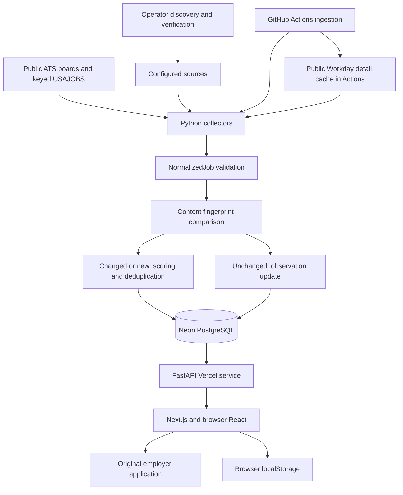

# System architecture and decisions

[Guide index](README.md) · [Detailed historical decisions](../design-decisions.md)

## Three workloads

1. **Ingestion:** Python workers fetch provider snapshots and write normalized,
   classified jobs. GitHub Actions owns the production process lifetime.
2. **Serving:** FastAPI reads stored jobs and aggregate operational metadata.
   Vercel serves the ASGI API and the Next.js frontend as separate services.
3. **Interaction:** React client components fetch JSON and manage filters,
   saved searches and tracking in the browser.

The diagram separates discovery from refresh: the ingestion workflow does not
search the web for employers every half hour. It seeds the reviewed registry
and refreshes enabled sources. Database egress is a separate concern from
provider HTTP traffic: downloading an employer description does not itself
download a stored description from Neon.

## Request and deployment boundaries

[vercel.json](../../vercel.json) routes `/api/*` to `backend` and other paths to
`web`. [vercel_app.py](../../vercel_app.py) mounts the existing FastAPI app under
`/api`. Locally, Uvicorn runs the inner app directly, so its jobs route is
`http://localhost:8000/jobs`. The deployed route is `/api/jobs`.

There is no Next.js API route, separate Express server, Celery worker or Redis
queue. Vercel request handlers do not run continuous ingestion. The persistent
store is PostgreSQL; SQLite is an explicitly configured local/test alternative.

## Why these choices exist

| Problem | Chosen approach | Alternative and tradeoff |
| --- | --- | --- |
| Interactive pages plus Python parsing | Next.js/React and FastAPI | One stack would reduce languages; this split suits the implemented Python ingestion code but requires parallel JSON/TypeScript contracts |
| Durable structured data and filters | PostgreSQL with SQLAlchemy and Alembic | SQLite is simpler locally but cannot establish PostgreSQL behavior; an external search cluster adds infrastructure without measured MVP need |
| Many independent third-party boards | Periodic isolated snapshots | Fetch-on-search adds latency and outage coupling; periodic jobs can be stale and schedules can be delayed |
| Inconsistent provider schemas | `NormalizedJob` before persistence | Provider-specific UI models spread parsing rules across the app; normalization can still lose unknown structure, so raw source data is retained |
| Explainable early-career ranking | Versioned deterministic rules and evidence | LLM/ML classification adds cost and harder reproducibility; rules miss unusual language and need reviewed evaluation |
| Uncertain suitability | Scores plus independent confidence and filters | Binary classification is simpler but discards useful borderline evidence; cutoff 50 is an observed operating choice, not universal truth |
| Stable provenance and permitted access | Original public ATS feeds and official USAJOBS | Aggregator scraping can have access/identity issues; public boards still change or restrict endpoints |
| MVP tracking without accounts | Local browser storage | Accounts enable sync but add identity/security/backend work; local data disappears when cleared or used on another origin |
| Cloud refresh without a worker service | GitHub Actions with secrets and concurrency | Dedicated scheduling offers stronger control; Actions timing is best effort and long runs serialize |
| Workday tenant variation | Observed hostname, tenant, site and locale | Guessing from company names is fragile; current support intentionally excludes unknown/custom/protected contracts |
| Hosted database transfer cost | Explicit projections and content hashes | Full-row ORM reads are convenient but transfer large raw bodies repeatedly; projections require careful response-contract maintenance |

## Rules to preserve

Keep provider failures isolated. Reconcile missing jobs only from a complete,
fully validated snapshot. Preserve source IDs, original links and unknown values.
Keep list queries compact, matching explainable, and secrets server-side. A public
admin page is an observation surface, not authorization to mutate production.
