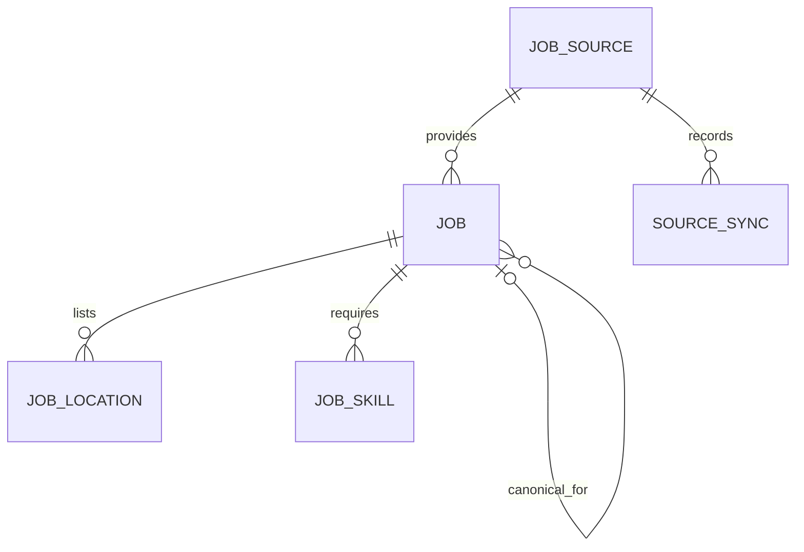

# Database and migrations

[Guide index](README.md) · [Model source](../../services/api/app/models/job.py)

## Six persistent models

| Model / table | Purpose and key identity |
| --- | --- |
| `JobSource` / `job_sources` | One provider board or configured federal query source; UUID PK, unique `(source_type, board_identifier)` |
| `Job` / `jobs` | Normalized posting plus classification, provenance and lifecycle; UUID PK, unique `(source_id, source_job_id)` |
| `JobLocation` / `job_locations` | Relational location rows for country/state filtering; integer PK, job FK |
| `JobSkill` / `job_skills` | Canonical extracted skills for indexed filtering; composite PK `(job_id, skill)` |
| `SourceSync` / `source_syncs` | One source attempt: timestamps, status, counters, error and HTTP/upsert timing; UUID PK, source FK |
| `IngestionRun` / `ingestion_runs` | One top-level sync invocation; UUID PK, status and aggregate JSON summary |

`IngestionRun` is intentionally outside this relational diagram: source attempts
do **not** have an `ingestion_run_id` FK. The run summary aggregates counters and
provider data; its file artifact also contains per-source results. Do not invent
a direct run-to-attempt join when debugging history. Relate timestamps and the
artifact with appropriate care.

## Job fields by responsibility

- **Identity/provenance:** internal UUID, source UUID, provider name, provider job
  ID, external requisition ID, source/apply URLs and `raw_data`.
- **Display/normalization:** company name/slug, title/normalized title, plain-text
  description, normalized URL/location, salary currency/period and employment text.
- **Classification:** role, seniority, required/preferred experience bounds,
  category, skills, score, fit label, confidence, conflict/evidence JSON and
  `matching_version`.
- **Geography/eligibility:** primary location, `locations` JSON, remote type,
  allowed/excluded states, timezone evidence, federal authorization/clearance
  metadata. A remote label is not proof of worldwide eligibility.
- **Lifecycle:** posting/source-update dates, first/last seen, deadline,
  active/closed state, first missing date, missing-run count, duplicate pointer.
- **Change detection:** description hash for duplicate comparison and nullable
  `ingestion_fingerprint` for full normalized-content comparison.

The description hash, ingestion hash and matching version serve different
purposes. Neither hash is a unique job identifier. `Job.match_score` exists as a
nullable legacy/reserved column; current dashboard ranking uses
`early_career_score`, not a personalized resume match.

`locations` and `detected_skills` JSON support public serialization. Separate
location/skill tables support SQL filtering. Upsert replaces their rows when
content changes, keeping those representations aligned. A missing field stays
unknown; inferred classification is stored separately from raw provider data.

## Constraints and indexes

Scores are constrained to 0–100. Salary values must be nonnegative and a bounded
range must be ordered. Useful indexes include dashboard active/country/score/date,
the expression `coalesce(posted_at, first_seen_at)` for freshness, duplicate keys,
normalized apply URL, location country/state/job, skill/job, source history and
run start time. Foreign keys link jobs to sources and aliases to canonical jobs.
Location/skill FKs have delete cascade, but normal job expiry does not delete jobs.

Generic JSON uses PostgreSQL JSONB via `JsonType`, and SQLite JSON locally.
Timestamps are timezone-aware at input and serialized as UTC. Decimal salary
storage uses `Numeric(14,2)`. PostgreSQL employment text supports long federal
labels; SQLite uses a string variant. SQLite success is not proof of PostgreSQL
JSONB comparisons, locking or migration behavior.

## Alembic chain

Migration files are in [versions](../../services/api/migrations/versions).

| Revision | Main change |
| --- | --- |
| `6ed2ad4faacd` | Initial jobs and source schema |
| `7bf8b519f9b4` | Source history, lifecycle and multiple locations |
| `4d3b3cd86b1c` | Matching evidence, skills and remote restrictions |
| `9f83a21cb4d0` | Freshness index and boolean storage adjustments |
| `1a4b0c4e2026` | Provider expansion configuration/metrics |
| `a12de0c2026` | PostgreSQL employment description widened to text |
| `b42f0c2026` | Ingestion operations/run records and source failure controls |
| `c53e0a2026` | Nullable ingestion fingerprint |

Run `python -m alembic current`, `history`, `upgrade head` and `check` against an
explicitly selected database. `check` detects model/schema drift; it does not
prove production was migrated. `Base.metadata.create_all` in unit fixtures also
does not exercise migration history. Use the migration tests and PostgreSQL CI.

For a schema change, inspect the generated Alembic operations and test an upgrade
from the preceding revision on disposable data. Prefer additive rollout. Arrange
a backup where practical before production changes. Never reset production,
delete historical revisions or use `stamp head` to conceal a missing column.
The production-maintenance workflow provides bounded migration timeouts and a
credential-free schema/count/index audit artifact.
