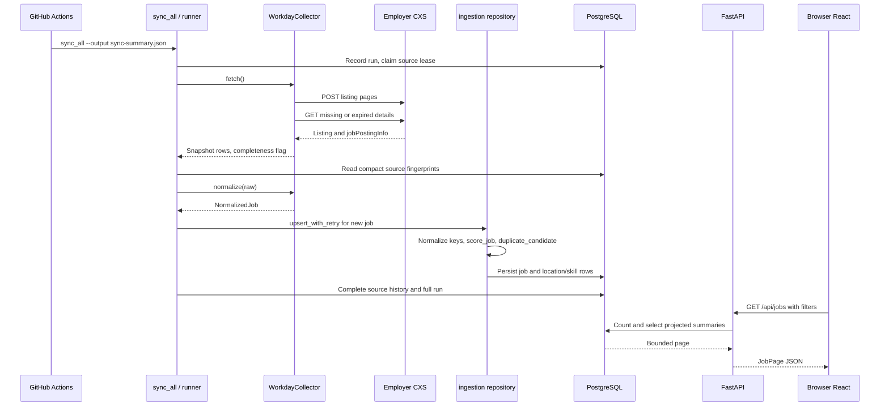
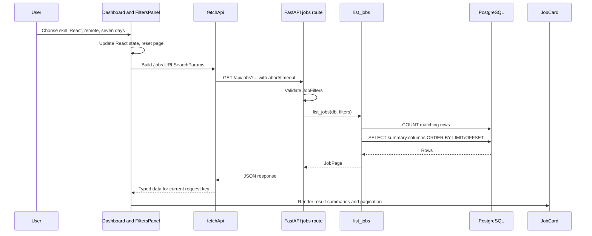

# Follow the data end to end

[Guide index](README.md) · [Ingestion](ingestion.md) · [Search](search.md)

These walkthroughs identify actual function boundaries. Employer posting and
user filters are illustrative; they are not fabricated live job observations.

## Follow one job through GradJobs

Assume an already verified Workday source is enabled and its employer publishes
a new “Junior Software Engineer” posting with React in the description.

1. [.github/workflows/ingestion.yml](../../.github/workflows/ingestion.yml) checks
   production PostgreSQL configuration, restores public detail cache, runs Alembic
   and source seeding, then invokes `python -m collectors.sync_all`.
2. [sync_all.py](../../collectors/sync_all.py) reads enabled sources, interleaves
   providers, creates the top-level run and gives this source to `sync_one()`.
   `runner.sync_source()` creates a per-source history and claims a lease.
3. [workday.py](../../collectors/workday.py) builds the observed tenant/site CXS
   endpoint, paginates summaries, validates paths and fetches needed details with
   bounded concurrency/retries. The source request is not a database transaction.
4. `normalize()` uses `jobPostingInfo.id` as `source_job_id`; the employer's
   `jobReqId` can be the separate external ID. It builds original URLs, plain text,
   explicit dates, salary if supported, primary/additional locations and raw data.
5. [shared/schemas.py](../../shared/schemas.py) validates `NormalizedJob`. A bad
   posting is recorded as a failure; an incomplete snapshot cannot close jobs.
6. [ingestion_state.py](../../collectors/ingestion_state.py) sees no existing ID,
   so the new job goes to `upsert_with_retry()` and then `upsert_job()`.
7. [repositories/ingestion.py](../../services/api/app/repositories/ingestion.py)
   computes duplicate keys and the content hash, calls `score_job(title, text)`,
   derives remote evidence and looks up a duplicate candidate. **Scoring happens
   before this candidate lookup in the actual implementation.**
8. Upsert assigns the GradJobs UUID, retains a duplicate pointer if appropriate,
   stores classification/evidence and replaces relational locations/skills. Batch
   commits preserve validated writes if another row fails later.
9. A complete snapshot reconciles missing IDs and history. `sync_all` performs
   deadline maintenance, completes the run and exports counters. Actions saves
   the public Workday cache and uploads the summary artifact.
10. Later, `/jobs` reads stored columns selected for `JobSummary`. React's
    `JobCard` displays title/company/location/experience/score/skills/source.
    The detail request fetches the description and evidence. Apply opens the
    original employer URL; GradJobs does not submit an application.

### Second sync branches

For the same active/current-version posting with identical normalized content,
the hash matches. No score recomputation or full-body readback is needed;
`last_seen_at` refreshes and `updated_at` remains unchanged. A real raw/description
change invalidates the hash and takes the changed upsert path. If the provider
snapshot is partial, unseen IDs remain protected from closure. If a posting is
absent across the configured complete-miss threshold, it becomes inactive but is
retained for history/tracking.

## Follow one user search

The user selects React skill, Remote, and Last 7 Days on `/`.

1. [FiltersPanel](../../apps/web/components/filters.tsx) calls the dashboard's
   state setter. These are browser state changes, not saved backend preferences.
2. [Dashboard](../../apps/web/components/dashboard.tsx) generates `skill=React`,
   `remote_type=remote`, a freshly computed UTC `fresh_after`, page 1 and page
   size 12, plus score/experience/seniority/demo defaults. Text typing is separately
   debounced 300 ms; choosing a skill is not the same as text `q=React`.
3. [fetchApi](../../apps/web/lib/api.ts) calls same-origin `/api` in production.
   It disables fetch caching, aborts obsolete requests and enforces 15 seconds.
   API query parameters change; the browser address bar does not mirror them.
4. Vercel routes the request to [vercel_app.py](../../vercel_app.py)'s `/api`
   mount and [api/routes.py::jobs](../../services/api/app/api/routes.py).
   Pydantic validates names, types, timestamp awareness and numeric bounds.
5. [list_jobs](../../services/api/app/repositories/jobs.py) requires active,
   canonical, unexpired U.S. jobs, score ≥50, non-senior/non-demo, required
   minimum ≤3 or unknown, canonical React skill, remote type and fresh date.
6. PostgreSQL uses skill/location relational predicates and filters stored values.
   Freshness is source posting date or discovery fallback, not last update time.
   With no text query, ordering begins with freshness bands, then score/confidence.
7. Count plus projected page rows become `JobPage`. Description/raw JSON do not
   travel for each card. Pydantic adds computed `is_new`; React renders cards and
   result total for the current request key.
8. Saving this search writes local filters/query/sort. Reopening it later computes
   a new seven-day cutoff and executes this same request path. No background
   notification job is created.

### Debug checkpoints

If a known posting is missing, first compare source history and the stored
classification, then reproduce the API filters, then inspect browser request
parameters. If the API returns the job but the UI does not render it, focus on
request cancellation, response-key state, TypeScript fields or rendering errors.
Do not change matching to solve a failed HTTP connection or a stale frontend build.
